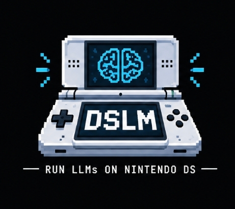

<p align="center">
  
</p>

# DSLM

A tiny LLM running **100% offline on a Nintendo DS**, launched from an **R4** flashcart. DSLM is a port of [`llama2.c`](https://github.com/karpathy/llama2.c) running the `stories260K` model, which writes short, simple stories in English.

> **Status:** v1.0.0 — runs on real hardware at **6.55 tokens/s** (int8 fixed point), token-for-token parity with the PC reference.

## Play it

1. Download **`dslm-v1.0.0.zip`** from [Releases](https://github.com/GCarin1/DSLM/releases/latest).
2. Unzip it at the root of your flashcart's microSD card (the kernel must already be installed).
3. Launch `dslm.nds`, type the start of a story (or press L/R for an example) and press START.

Controls, settings and troubleshooting: [`docs/user-guide.md`](docs/user-guide.md). Tested carts and emulators: [`docs/compatibility.md`](docs/compatibility.md). What changed: [`CHANGELOG.md`](CHANGELOG.md).

| Build | Time per token on a DS | Tokens/s |
|---|---|---|
| int8 fixed point (default) | 152.7 ms | 6.55 |
| fp32 reference | 627.5 ms | 1.59 |

## Build it

Everything builds in Docker (`docs/building.md`): `make all` runs the tests and builds `dslm.nds`; `make package` builds the install zip. Pushing a `v*` tag runs `.github/workflows/release.yml`, which tests, builds and publishes the release assets.

## Why it's hard

- **No FPU:** the ~67 MHz ARM9 emulates every `float` in software.
- **About 3.5 MB of usable RAM:** the binary, weights, KV cache and buffers all share it.
- **No OS:** no `mmap()`, no threads. Weights are read once from the microSD card through DLDI.
- **"R4" is not one cart:** dozens of clones, kernels and DLDI drivers.

## What makes DSLM different

LLMs have already reached the DS ([chatds](https://github.com/papayuh/chatds), ds-llm; see [prior art](docs/prior-art.md)). DSLM aims at two things nobody has published yet:

1. **Exact parity:** token-for-token identical output to `llama2.c` on a PC (temperature 0).
2. **Real-hardware numbers:** load time, tokens per second and heap peak measured on an actual R4, not in an emulator.

## Roadmap

Emulator first (melonDS), real R4 second. Success criteria SC1–SC6 are defined in [`product.md`](.doctrina/product.md).

| Milestone | Deliverables | Exit criteria | Realizes | Status |
|---|---|---|---|---|
| **M0 — Plan** | Product, 6 specs, file-format contract, ADRs 0001–0005, docs, Doctrina skills | Doctrina gates green | — | ✅ Done |
| **M1 — Toolchain & card I/O** | Pinned BlocksDS (Docker/script); hello-world `.nds` that parses `/dslm/dslm.ini` via DLDI | Runs in melonDS (sync folder) **and** on the reference R4 | SC1 (partial) | ✅ Done |
| **M2 — PC toolchain** | `tools/`: download, inspect + memory budget, stage card, golden outputs from a pinned `llama2.c` commit | `stories260K` budget < 3.5 MB; golden outputs reproducible | SC2, SC5 | ✅ Done |
| **M3 — fp32 skeleton (emulator)** | `run.c` port: loader, forward pass, tokenizer, sampler; fixed prompt on the console; headless melonDS parity script | Zero divergence vs golden output in melonDS | SC2 (emulated) | ✅ Done |
| **M4 — Hardware bring-up** | Same build on the reference R4; DLDI fallback documented; first `benchmarks/` file | Parity on hardware; fp32 baseline recorded | SC1, SC2, SC6 | ✅ Done (153/153 tokens, 627.5 ms/token fp32) |
| **M5 — Fixed point / int8** | int8 format in the contract, quantizer, ITCM matmul, fixed-point RMSNorm/softmax/SiLU | Parity vs `runq.c`; ≥ 3 tok/s on hardware (provisional) | SC3, SC6 | ✅ Done (6.55 tok/s on the R4, 4.1x fp32) |
| **M6 — Interface** | On-screen keyboard, token streaming, B to cancel, settings from `dslm.ini` | UI acceptance criteria pass on hardware | SC4 | ✅ Done (melonDS and R4) |
| **M7 — v1.0 release** | Release `.nds` + staging script, complete docs, benchmark and cart-compatibility tables | Every spec `verified`; release notes with hardware numbers | SC5, SC6 | ✅ Done (v1.0.0) |
| **M8 — Beyond v1.0** *(optional)* | Custom 100K–1M parameter models; DSi-mode bonus via TWiLight Menu++ | — | — | Optional |

## Project map

DSLM uses [Doctrina](https://github.com/GCarin1/Doctrina) for spec-driven development.

| Where | What |
|---|---|
| [`.doctrina/product.md`](.doctrina/product.md) | Vision, scope, success criteria, delivery order |
| [`.doctrina/specs/`](.doctrina/specs/) | `model-loading`, `inference-engine`, `fixed-point-inference`, `ds-interface`, `pc-toolchain`, `test-harness` |
| [`.doctrina/contracts/model-file-format.md`](.doctrina/contracts/model-file-format.md) | microSD layout, checkpoint/tokenizer formats, `dslm.ini`, `bench.txt`, memory budgets |
| [`.doctrina/decisions/`](.doctrina/decisions/) | ADRs 0001–0009: llama2.c base, whole model in RAM, fixed point + fp32 reference, BlocksDS, console UI, int8 format, fixed-point engine, reference hardware & kernel policy |
| [`.doctrina/skills/`](.doctrina/skills/) | Agent skills: `r4-deploy`, `emulator-testing`, `ds-memory-budget` |
| [`docs/hardware-ds.md`](docs/hardware-ds.md) | DS hardware, usable RAM, microSD read speed |
| [`docs/r4-flashcart.md`](docs/r4-flashcart.md) | Identifying the cart, kernels, card layout, DLDI patching |
| [`docs/testing.md`](docs/testing.md) | melonDS, DeSmuME, no$gba and the hardware runbook |
| [`docs/prior-art.md`](docs/prior-art.md) | LLMs on the DS and other `llama2.c` ports |
| [`docs/risks.md`](docs/risks.md) | Risk register with mitigations |
| [`benchmarks/`](benchmarks/) | Hardware results (one file per run) |

## Target hardware

- Nintendo DS or DS Lite, in DS mode.
- **Reference cart:** the R4 clone with the YSMenu kernel used for M4 (`benchmarks/2026-11-25-r4-ysmenu.txt`). Other DLDI carts, including the original R4 with Wood R4 1.62, are best-effort (ADR 0009).
- DSLM never ships kernels or firmware. See [`docs/r4-flashcart.md`](docs/r4-flashcart.md).

## Open questions

- None blocking. Next candidates: v1.0 release notes and compatibility table (M7), D-pad typing (ADR 0006), the DS hardware divider for more speed.

## Documentation gates

```bash
npm install
npx doctrina validate && npx doctrina clarify --all && npx doctrina trace
```

The same gates run in GitHub Actions on every push.

## Credits

Built on [`llama2.c`](https://github.com/karpathy/llama2.c) by Andrej Karpathy (MIT). Informed by chatds, ds-llm, the C64, PSP, PS Vita and DOS ports, the [flashcard archive](https://github.com/flashcarts/flashcard-archive) and the [BlocksDS](https://blocksds.skylyrac.net/) docs.

## License

MIT, see [`LICENSE`](LICENSE). The inference code is ported from [`llama2.c`](https://github.com/karpathy/llama2.c) and the stories260K model comes from `karpathy/tinyllamas`, both MIT ([`third_party/llama2.c/LICENSE`](third_party/llama2.c/LICENSE)).
