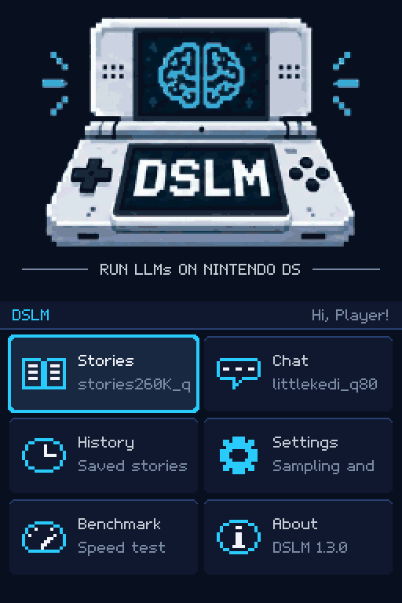
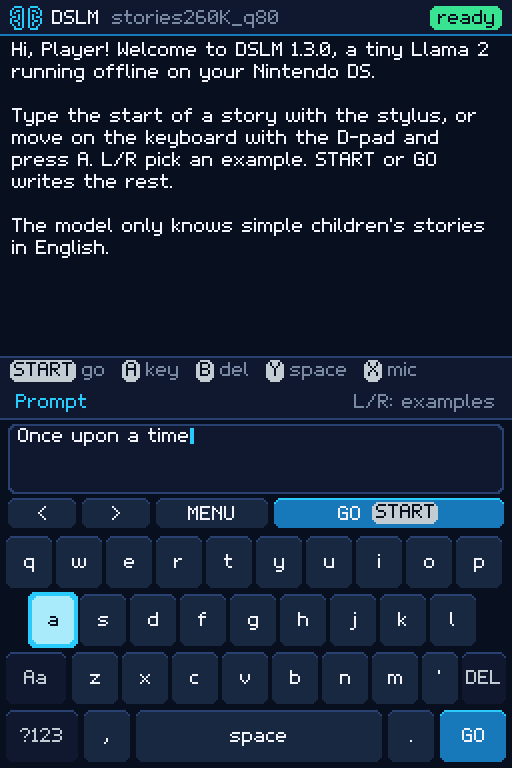
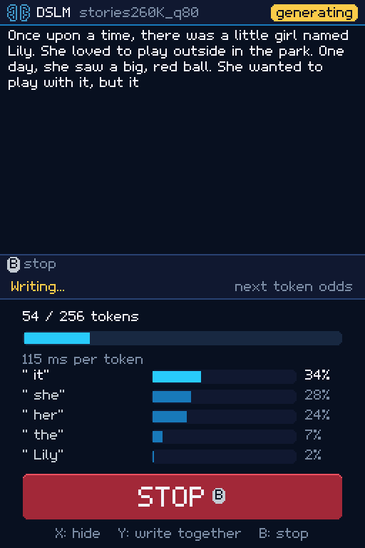
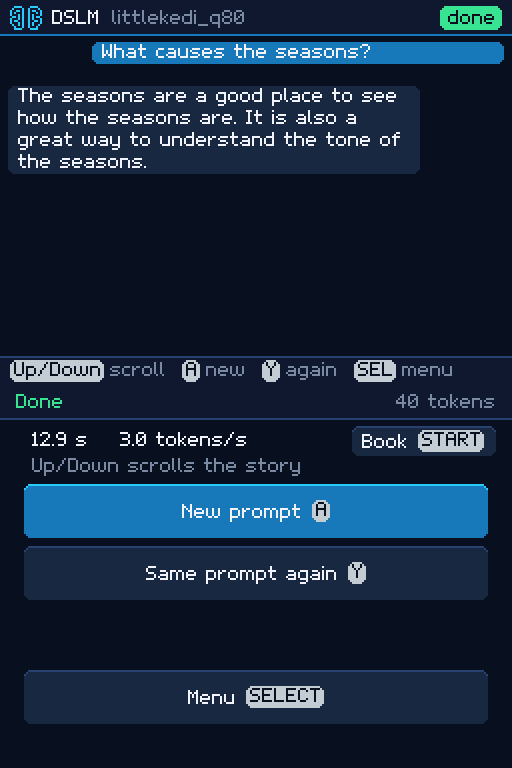
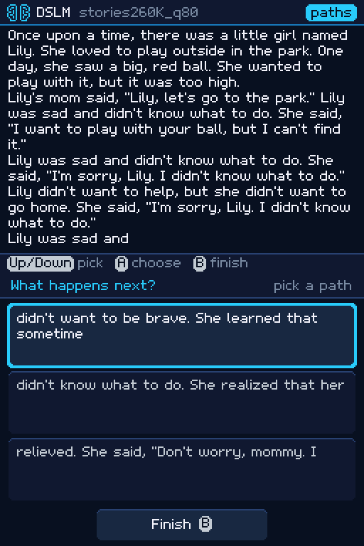
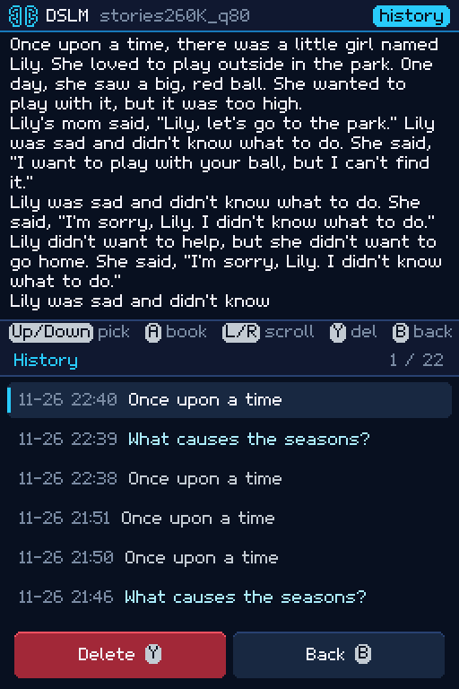
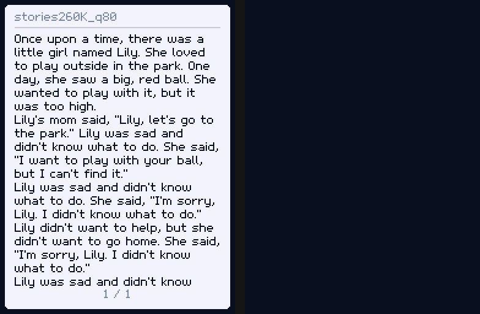

# DSLM 1.3.0-1 — a real DS app

DSLM 1.3.0-1 is a parallel build of 1.3.0: the same models, settings and card layout. The notes below are those of 1.3.0.

DSLM runs small language models **entirely offline** on a Nintendo DS, DS Lite or DSi (in DS mode), launched from an R4 flashcart. Version 1.3.0 replaces the text-console interface with a graphical one in the colours of the DSLM logo. It adds a Home menu, its own keyboard, sounds and a history, plus new ways to see and steer what the model is doing.

## Screenshots

<table>
  <tr><td align="center"> Home: pick a mode</td><td align="center"> Type with the stylus or the D-pad</td><td align="center"> Peek: the next-token odds</td></tr>
  <tr><td align="center"> Chat with LittleKedi</td><td align="center"> What happens next? Pick a path</td><td align="center"> History of saved stories</td></tr>
</table>

 Book mode: hold the DS sideways and read across both screens

## Download and install

1. Download **`dslm-v1.3.0-1.zip`** below.
2. Unzip it at the **root** of your flashcart's microSD card (the kernel must already be installed). If you are upgrading, unzip over the old files. Your `dslm/dslm.ini` is replaced by the default one, and an old one also still works.
3. Launch `dslm.nds`. The Home screen opens after the logo: pick **Stories** or **Chat** with the D-pad and A, or by touch.

## What's New

- **New look.** Both screens are drawn as graphics, with an original pixel font, rounded buttons that name the DS button that presses them, a title bar with the model and its state, and the logo while a model loads. The flashcart menu shows a brain icon.
- **Home screen.** Six cards: **Stories**, **Chat** (loads LittleKedi by itself), **History**, **Settings**, **Benchmark** and **About**. DSLM remembers the last mode and greets you by the name set in the DS System Settings.
- **Its own keyboard.** QWERTY with keys twice as large. Type with the stylus or without it: the D-pad moves the highlight and A types the key. B deletes, Y adds a space, `Aa` makes a capital and `?123` opens numbers and symbols.
- **Sounds.** Original clicks and chimes made by the DS sound chip itself. They can be switched off in Settings.
- **History.** Every finished story and answer is saved to `/dslm/history` with its date. Read it again, read it as a book, or delete it.
- **Peek inside the model** (X while a story model writes): the five tokens it found most likely at each step, with their odds.
- **Write together** (Y while it writes): pick each next token yourself among its five favourites.
- **What happens next?** (X on the Story screen): three different continuations of your story. Pick one, and three more follow.
- **Book mode** (START on the Story screen): hold the DS sideways like a book and read on light pages across both screens.
- **Voice mode** (X on the prompt screen): blow on the DS to start a story. The louder you blow, the more creative that story is.
- **Battery mode.** Close the lid while the model writes: the screens turn off, it keeps going, and the DS sleeps when it is done. A red icon warns of a low battery.
- **Benchmark card.** Measures your DS and adds the result to `/dslm/bench.txt`.
- **Personal touches.** A Colour setting can use your DS favourite colour as the accent.

## Changes and defaults

- **Controls.**
  - On the prompt screen START (or GO) generates, and A types the highlighted key.
  - SELECT goes back to Home from the prompt and story screens. Settings is opened from Home.
  - A short press of B stops a generation; it no longer has to be held.
- **Settings screen.** The Model row lists only story models (the chat model has its own card). Settings also gained the Sound and Colour rows.
- **`dslm.ini`.** New keys `chat_checkpoint` under `[model]`, and a new `[ui]` section with `mode`, `sound`, `accent` and `peek`. Older files keep working: a chat model named as `checkpoint` opens in Chat mode.
- **Models.** The default model and the packaged models are unchanged, and so is every model's output (token-for-token parity).

## Bug Fixes

- A held touch on Settings' Back could type a key on the prompt keyboard.

## Technical

| Model | Tokens/s on a DSi (DS mode), 128 steps | Heap peak | Parity |
|---|---|---|---|
| stories260K int8 (default) | 7.68 | 1.37 MB | 129/129 vs golden on hardware |
| tiny1m int8 | 4.93 | 2.42 MB | golden on melonDS |
| LittleKedi int8 (chat) | 3.13 | 3.42 MB | golden on melonDS |
| stories260K fp32 | 1.76 | 1.78 MB | golden on melonDS |

- These were measured with the new Benchmark card (first example, temperature 0, 128 steps) on a DSi in DS mode with the reference R4 clone (YSMenu), using DS hardware timers (`emulated=no`). Earlier releases measured 256 steps, and later tokens take a little longer. On the same emulator the new interface writes as fast as 1.2.0 or slightly faster: 256 int8 steps took 35.5 s against 36.7 s.
- **Interface.** Both screens are 8bpp bitmaps (mode 5) drawn in software. Assets are embedded in the .nds and decompressed by the BIOS into VRAM. Animations (fades, the pulsing brain, sounds) run only on hardware or in the VBlank interrupt, so they cost no generation time. Input is latched in the VBlank interrupt (ADRs 0011-0015).
- **Engine.**
  - An optional step hook (the visualizer and co-writing) and step-by-step continuation (the paths) were added.
  - Host tests prove they leave generation unchanged. Forcing the top token reproduces the greedy golden, and continuing after a stop equals an uninterrupted run.
- The binary is 241 KB (1.2.0: 217 KB), and LittleKedi still loads with the same heap peak. The released `dslm.nds` differs from the measured build only by its version string.

## Full Changelog

See [`CHANGELOG.md`](https://github.com/GCarin1/DSLM/blob/v1.3.0-1/CHANGELOG.md) and https://github.com/GCarin1/DSLM/compare/v1.3.0...v1.3.0-1

## Assets

| File | What it is |
|---|---|
| `dslm-v1.3.0-1.zip` | **The install package.** Unzip at the microSD root. Contains `dslm.nds`, the four models, both tokenizers, `dslm.ini`, `README-DSLM.txt`, `MANIFEST.txt`, `LICENSE.txt` and `THIRD_PARTY.txt`. |
| `dslm.nds` | The program alone, for updating an existing 1.2.0 install (the models are unchanged). |
| `SHA256SUMS.txt` | SHA-256 of every asset. |

DSLM is MIT-licensed. stories260K and the original inference code are by Andrej Karpathy (MIT). tiny1m is by shibatch (MIT). LittleKedi is by edededdy (Apache-2.0), converted and quantized by DSLM. The interface art, pixel font and sounds are original to DSLM.
